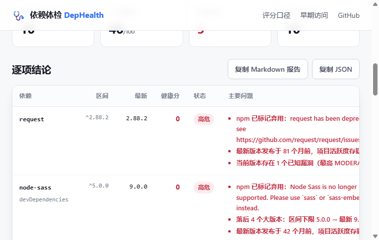

# 依赖体检 · DepHealth

> 粘贴一份 `package.json`，30 秒内拿到一张依赖风险清单：每个包落后几个大版本、是否被 npm 标记弃用、当前版本有多少已知漏洞、下载量是否已崩、许可证是否踩雷。

**在线使用：<https://elsonshow.github.io/dep-health/>**（无需登录、无需安装、不上传代码）

> 状态：v0.1 早期版本。免费功能可用。**觉得这份清单值 ¥10，可以自愿付费买断：<https://elsonshow.github.io/dep-health/paid.html>**（微信支付，一次性，不订阅）。

> 更长期的团队版（CI 门禁、变更周报）是否继续做，取决于有没有人真的需要它（见下方「付费意向」）。

---

## 它解决什么问题

一个用了三年没大改的项目，`package.json` 里通常躺着：

- 已经被 npm 官方标记弃用的包（`request`、`node-sass`……）——`npm install` 照样成功，出事是半年后；
- 落后好几个大版本的框架——每次升级都更贵，但没人知道"现在到底落后多少"；
- `axios@0.21.1` 这种带着二十几个已知漏洞的旧版本——`npm audit` 会告诉你，但你不会每天都跑；
- 许可证踩雷（GPL 进了运行时依赖）；
- 周下载量已经跌到三位数的"僵尸包"——文档还在，维护者已经走了。

这些信息分散在 npm registry、GitHub、OSV、许可证文件里。**没有人在 `npm install` 之前会去逐个查。** 这个工具就是把这一步压到 30 秒。

## 怎么用

1. 打开 <https://elsonshow.github.io/dep-health/>
2. 粘贴 `package.json`（或点「载入示例」）
3. 拿结果：健康分 + 每条结论的依据
4. 「复制 Markdown 报告」→ 直接贴进 PR / issue / 周报

4. 「下载交付报告 (.html)」→ 一份可独立打开/打印的报告，**带处理顺序**和逐条证据
5. 「复制分享链接」→ 结论表被打包进 URL 片段，别人打开就能看到，不经过任何服务器

交付报告和免费表格的差别只有两点，但都是实的：**给出先升哪个的顺序**，以及**每条结论带证据和数据来源**。它不编造「升级到某版本就修好了」这类从数据推不出来的结论。

样例：[report-sample.html](../state/experiments/EXP-LEAD-005/report-sample.html)（用示例项目真实跑出来的）

也可以用 `?autorun=1` 直接跑内置示例：<https://elsonshow.github.io/dep-health/?autorun=1>

> 分享链接只带结论表（依赖 / 区间 / 最新版 / 健康分 / 状态 / 首条问题），不带逐条证据，
> 所以不会被 25 个依赖撑爆 URL。数据全在 `#r=` 后面，打开时本地解码，不发请求。



## 实测与指南

不是营销页，是拿 npm 公开接口跑出来的数据和分析，脚本可复现：

- **[依赖里出现 deprecated 警告，到底要不要管？48 个包的实测答案](https://elsonshow.github.io/dep-health/deprecated-warning.html)**
  —— 把弃用包分成「不用管 / 值得排期 / 必须尽快处理」三档，附 30 秒自查命令。
- **[npm 依赖现状实测：34 个已被官方弃用的包，每周仍被下载 6.92 亿次](https://elsonshow.github.io/dep-health/npm-deprecated-2026-11.html)**
  —— 2026-11-24 的 registry 快照，含完整名单与逐包下载量。
- **[升级风险评估：落后几个大版本 ≠ 该不该升级](https://elsonshow.github.io/dep-health/upgrade-risk.html)**
  —— 同样的「落后」，typescript 已稳定 139 天可以升，vitest 才发布 6 天不该碰。按发布时间判断风险。
- **[弃用包速查表](https://elsonshow.github.io/dep-health/risk-index.html)**
  —— 按周下载量排序的静态清单，可直接对照自己项目。

数据与生成脚本都在仓库里：[`data/risk-index.json`](data/risk-index.json)、
[`scripts/build-risk-index.js`](scripts/build-risk-index.js)、
[`scripts/verify-article.mjs`](scripts/verify-article.mjs)。

## 数据来源（全部是公开官方接口）

| 数据 | 来源 | 用途 |
| --- | --- | --- |
| 最新版本、弃用标记、许可证、直接依赖数 | `registry.npmjs.org/<pkg>/latest` | 版本落后 / 弃用 / 供应链面积 |
| 版本发布时间 | `api.deps.dev` | 停更像判断 |
| 周下载量 | `api.npmjs.org/downloads` | 社区活跃度 |
| 已知漏洞 | `api.osv.dev` | 漏洞风险 |

**所有计算都在你的浏览器里完成**，代码和 `package.json` 不会离开本机，站点不使用 Cookie、不加载任何第三方追踪脚本。

## 性能与规模

每个依赖要打 4 个公共端点（registry / deps.dev / 下载量 / OSV），所以耗时随依赖数近似线性。
以下是 **91 个真实存在的包** 的实测（同一份 package.json，只改并发）：

| 并发 | 耗时 | 结果 |
| --- | --- | --- |
| 5 | 29.5s | 91/91 全部取数成功 |
| **12（默认）** | **14.1s** | 91/91 全部取数成功 |
| 20 | 8.4s | 91/91 全部取数成功 |

三档的逐包结果**完全一致**（平均分 42、高危 14、unknown 0），提速没有牺牲正确性。

默认取 12 而不是 20：这几个端点都不是自家服务，并发压太狠容易被限流，
一旦限流用户看到的是 `unknown` 而不是结论——用稳定性换 5.7 秒不值得。

依赖数很多时可以用 `max-deps` 控制分析量（见上表），截断会按风险优先级选取，
不会因书写顺序漏掉高危项。

## 在 CI 里用（GitHub Action）

单次体检解决不了「持续」的问题。所以同一个引擎也做成了 Action：PR 里直接看到体检报告，还能按阈值拦住合并。

```yaml
# .github/workflows/dep-health.yml
name: 依赖体检
on: [pull_request]

permissions:
  contents: read

jobs:
  audit:
    runs-on: ubuntu-latest
    steps:
      - uses: actions/checkout@v4
      - uses: elsonshow/dep-health@v1
        with:
          path: package.json
          fail-on: critical   # none | critical | risk
```

报告写进 Job Summary（PR 页面直接可见）。参数：

| 输入 | 默认 | 说明 |
| --- | --- | --- |
| `path` | `package.json` | 要体检的清单文件 |
| `fail-on` | `none` | `none` 只出报告；`critical` 有弃用或高危漏洞就失败；`risk` 平均分 <65 或存在 critical 就失败 |
| `max-deps` | `25` | 最多分析多少个依赖，`0` 表示不限制 |
| `include-dev` | `true` | 是否包含 devDependencies |

| 输出 | 说明 |
| --- | --- |
| `score` | 平均健康分 |
| `critical` | 高危依赖数量 |
| `report` | 完整 JSON 报告 |

这个仓库自己也在用它，配置文件见 [`docs/workflow-example.yml`](docs/workflow-example.yml)（直接复制到 `.github/workflows/` 即可）。示例项目 `examples/legacy-app` 是一个 2021 年停更的项目，故意留着一堆问题用来演示门禁。

> 说明：Action 的逻辑已在本地用真实数据验证（`node action/index.js`，含 `fail-on=critical` 返回 exit 1），
> 但**尚未在 GitHub Actions 上真实跑过一次** —— 仓库所有者当前的 gh token 没有 `workflow` 权限，无法推送 workflow 文件。
> 这一条等权限开通后补上，不做虚假声明。

## 健康分怎么算

从 100 分开始扣，扣分明细全部显示在结果里：

| 维度 | 扣分 |
| --- | --- |
| 已被 npm 弃用 | 直接压到 ≤12 |
| 落后大版本 | 每个 −22，最多 −60 |
| 落后小／补丁版本 | −7 / −2 |
| 最新版本发布距今 ≥24 / ≥12 / ≥6 个月 | −18 / −13 / −6 |
| 周下载 <500 / <5000 / <5 万 | −12 / −7 / −3 |
| 已知漏洞（按严重度加权） | 最多 −45 |
| 最新版本自身 ≥20 个直接依赖 | −6 |
| 运行时依赖为 copyleft 许可证 | −6 |

状态阈值：**≥85 健康 · 65–84 关注 · 40–64 风险 · <40 高危**。

> 健康分是启发式建议，不是安全认证。漏洞数据依赖 OSV 的报告，可能有延迟；「区间下限」是你声明的最低可解析版本，包管理器实际装的可能更高。上线前仍应以 `npm audit` 和人工评审为准。

### 漏洞是按「范围下限」审计的

这一条最容易误解，单独说明。

工具用一个依赖的**范围下限**去查漏洞，而不是你机器上实际装的版本。例如：

```json
"axios": "^1.7.9"
```

- 范围下限是 **1.7.9**，工具按 1.7.9 查 OSV
- 1.7.9 有 33 个已知漏洞（13 HIGH）
- 但 `^1.7.9` 实际会解析到 **1.21.1**，而 1.21.1 是 **0 漏洞**

所以报告里写的是「范围下限 1.7.9 有 33 个已知漏洞；实际安装的可能已是 1.21.1，请以 `npm ls` 为准」。

**为什么不直接查实际版本？** 因为 Action 只读 `package.json`，不读 `package-lock.json`，
拿不到你实际锁定的版本。范围下限是唯一能确定的下界。

**门禁怎么判断（重要）**

- 写 `^1.7.9` / `~1.7.9` 这类**可升级范围** → 下限漏洞**不会**让 CI 失败
  （因为 npm 会装范围内更新的版本，下限漏洞对当前项目是误报）
- 写 `1.7.9` 这类**精确锁定** → 下限就是实际版本，漏洞**会**让 CI 失败
- 已被官方弃用 → 不论写法都会失败
- 已在最新版且仍有 HIGH 漏洞 → 会失败（升无可升）

想要以「实际版本」为准，本地跑一次 `npm audit` 并用 `npm ls <包名>` 确认；
本工具定位是「安装之前」的快速筛查，不是替代 `npm audit`。

## 已知限制

- 只分析**直接依赖**（最多 25 个），不做传递依赖树；
- 不做锁文件分析——同一份 `package.json`，`package-lock.json` 装出来的版本可能不同；
- 不判断"这个包是否真的被用到"；
- 浏览器直连公开 API，受对方限流影响；某些包拿不到数据时会显示「未知」而不是猜。

## 路线图 / 付费意向

免费版会一直是免费的。打算做（也可能不做）的是**团队版**：

- GitHub Action：PR 自动评论体检结果，只报新增问题
- 阈值与 allowlist：把"停更超过 24 个月"这类规则变成 CI 门禁
- 依赖变更历史与周报

**如果你真的会为它付费，请开一个 issue 告诉我场景：[登记付费意向](https://github.com/elsonshow/dep-health/issues/new?template=early-access.yml)。**
登记数是 0 的话，项目就停在这里，不会包装成一个假装的生意。

## 开发

纯静态，无构建步骤：

```bash
node ops/devserver.js 4173 products/dephealth   # 本地预览
node products/dephealth/_selftest.js            # 引擎自测
```

部署：推送 `main` 分支，GitHub Pages 自动发布。

## License

MIT
